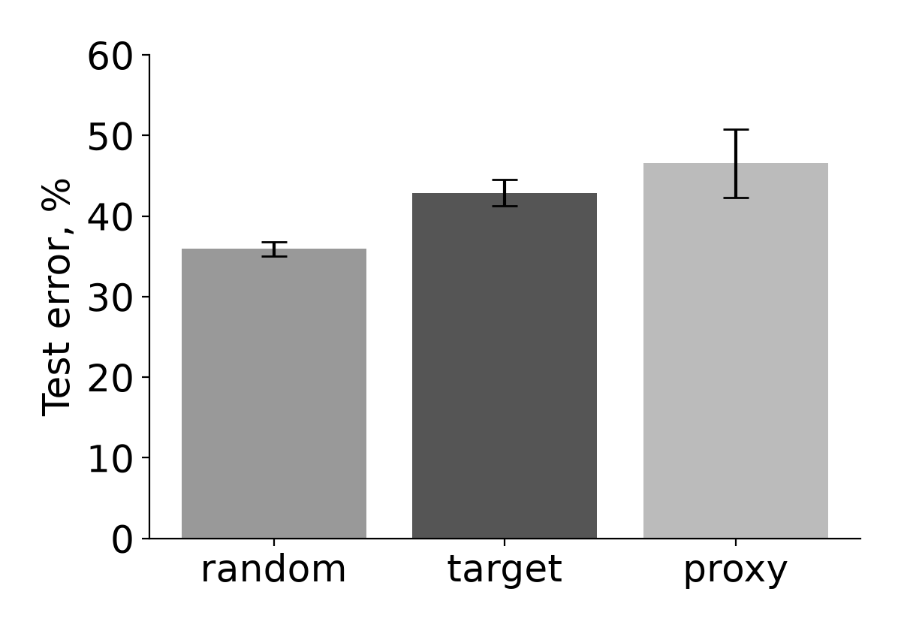
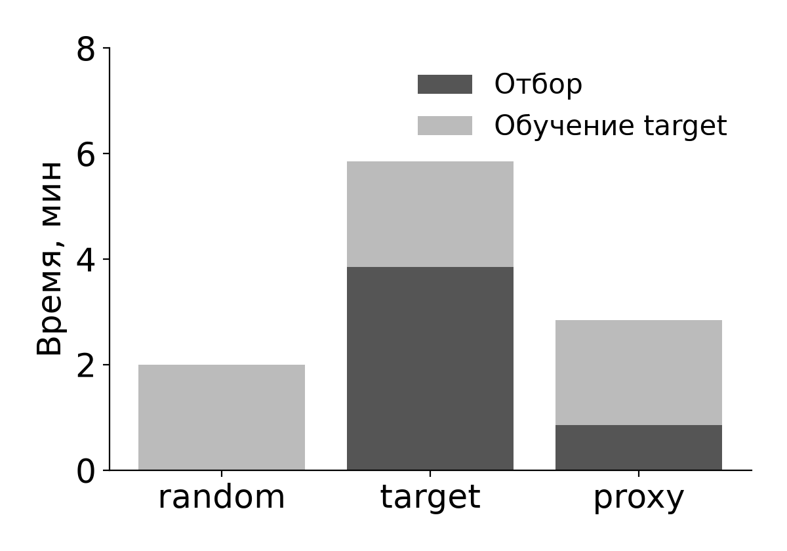

# Selection via Proxy: воспроизведение

Active Learning на CIFAR-10: random, отбор ResNet-164 и отбор ResNet-20. Девять запусков с бюджетом 10 000 изображений.

## 1. Метод

Coleman et al., Selection via Proxy: Efficient Data Selection for Deep Learning, ICLR 2020 [1]. В SVP критерий отбора вычисляет proxy-модель с меньшей стоимостью обучения. Итоговый классификатор target обучается с нуля на выбранных данных. Качество оценивается по ошибке target на тестовом наборе.

Рассматриваются Active Learning и Core-set Selection. В Active Learning размечен начальный набор. В каждом раунде модель отбирает объекты для разметки, после чего обучается с нуля на накопленном наборе. В экспериментах Core-set Selection метки исходного набора известны. Для итогового обучения отбирается одно подмножество.

Критерий отбора и архитектура target одинаковы при сравнении режимов. Стоимость proxy снижается за счёт архитектуры или числа эпох. Веса proxy в target не передаются.

| Критерий | Как выбираются примеры | Задача в статье |
| --- | --- | --- |
| Least confidence | Наибольшее значение 1 минус максимальная вероятность класса | Active Learning |
| Greedy k-centers | Поочерёдно добавляется пример, наиболее удалённый от ближайшего выбранного в пространстве признаков | Обе задачи |
| Forgetting events | Наибольшее число переходов от верного ответа к ошибке при обучении; никогда не распознанным примерам задаётся бесконечный счётчик | Core-set Selection |
| Max entropy | Наибольшая энтропия предсказанного распределения | Core-set Selection |

Авторы измеряют корреляцию рангов между моделями разного размера. Для forgetting events на CIFAR-10 корреляция ResNet-20 и ResNet-164 составляет около 0.90; для entropy и k-centers она ниже. На Amazon Review Full отбор по неуверенности не снизил ошибку относительно случайного отбора.

Результаты статьи для CIFAR-10: least confidence, бюджет 10 000 изображений, итоговая ResNet-164. Приведены среднее и стандартное отклонение по трём запускам [1].

| Отбор | Test error, % | Ускорение выбора |
| --- | --- | --- |
| Случайный | 12.9 ± 0.37 | - |
| ResNet-164 | 10.4 ± 0.38 | 1.0× |
| ResNet-20 | 10.5 ± 0.42 | 5.8× |

Время отбора включает обучение выбирающих моделей и вычисление критерия на пуле. Итоговое обучение в этот замер не входит.

## 2. Эксперимент

CIFAR-10, Active Learning с least confidence. Каждая модель обучается 15 эпох. Конечный размеченный набор содержит 10 000 изображений, исходный пул - 50 000, тест - 10 000.

| Настройка | Код авторов | Эксперимент |
| --- | --- | --- |
| Train-пул / test | 50 000 / 10 000 | 50 000 / 10 000 |
| Начальный набор | 1 000 | 1 000 |
| Накопленные размеры | 5 000, 10 000, 15 000, 20 000, 25 000 | 3 000, 5 000, 7 500, 10 000 |
| Эпохи на каждое обучение | 1 / 90 / 45 / 45 | 1 / 6 / 4 / 4 |
| LR по этапам | 0.01 / 0.1 / 0.01 / 0.001 | Те же значения |
| Повторения | 3 запуска | Seed 0, 1, 2 |

Режимы: random выбирает случайно без повторов; target выбирает через ResNet-164; proxy выбирает через ResNet-20. Во всех режимах итоговая модель - новая ResNet-164, обученная на 10 000 выбранных изображений. Для одного seed начальные 1 000 изображений одинаковы.

В режимах target и proxy модель отбора обучается с нуля в каждом из четырёх раундов. Для оставшегося пула вычисляется 1 - max(softmax(logits)). По убыванию этой оценки выбираются 2 000, 2 000, 2 500 и 2 500 изображений. Метки CIFAR-10 имитируют ответ разметчика; при ранжировании они не используются.

PreAct ResNet-20 и ResNet-164 адаптированы из кода авторов [2]. Обучение: cross entropy, SGD, batch 128, momentum 0.9, weight decay 0.0005. Для train применяются random crop 32×32 с padding 4 и horizontal flip. Для выбора и теста используется только нормализация. Протокол: FP32, TF32 выключен, последние веса, без выбора эпох по test.

Оборудование: RTX 4070 Ti SUPER, 16 ГБ. Окружение: Python 3.12, PyTorch 2.11.0+cu128, torchvision 0.26.0. Зависимости зафиксированы в uv.lock.

Проверки кода: размер и уникальность каждого набора; диапазон индексов; отсутствие повторного выбора; одинаковый старт режимов; разделение train/test. Train и pool используют одни исходные изображения с разными преобразованиями. Test используется только после итогового обучения. Архитектуры сверены с реализацией авторов по числу параметров, прямому проходу и градиентам. Все девять запусков прошли проверки размеров, индексов и конечности метрик.

Запуск из hw2: uv run run.py --short --mode all --seed N --device cuda. Значения N: 0, 1, 2.

## 3. Результаты

Девять запусков, seed 0, 1, 2. Test error = 100 - accuracy. Для ошибки приведены среднее и выборочное стандартное отклонение, для времени - среднее по трём запускам. Исходные значения сохранены в results/short/runs.csv.

| Режим | Test error, % | Выбор, с | Итоговое обучение, с |
| --- | --- | --- | --- |
| random | 35.92 ± 0.91 | 0.0012 | 119.98 |
| target | 42.87 ± 1.64 | 231.24 | 119.75 |
| proxy | 46.55 ± 4.23 | 51.10 | 119.71 |

Ускорение отбора target / proxy: 4.53 ± 0.01 раза. Отношение считается отдельно для каждого seed. Суммарное время отбора и итогового обучения составляет 5.85 минуты для target и 2.85 минуты для proxy; ускорение по отношению средних времён - 2.05 раза. Вся серия из девяти запусков заняла 32.47 минуты.

Время отбора включает обучение всех выбирающих моделей и проходы по пулу. CUDA синхронизируется на границах замеров. Скачивание данных, тест и построение графиков в указанные времена не входят.

Рис. 1. Слева test error, среднее ± std. Справа среднее время отбора и итогового обучения. CIFAR-10, бюджет 10 000, три seed.

Минимальная ошибка у random: 35.92%. Ошибка target выше на 6.95 п.п., proxy - на 10.63 п.п. Разность proxy и target составляет 3.69 п.п. Стандартное отклонение proxy - 4.23 п.п., target - 1.64 п.п.

Отбор с proxy занимает 51.10 с вместо 231.24 с, однако оба метода Active Learning уступают random по ошибке. В статье при бюджете 10 000 ошибка target составляет 10.4%, proxy - 10.5%; в эксперименте - 42.87% и 46.55%. Протоколы различаются длительностью обучения и последовательностью раундов. Недостаточное обучение моделей отбора может быть одной из причин расхождения. Число эпох и раунды изменены одновременно, поэтому их влияние отдельно не измерено.

## Источники

1. Coleman et al. Selection via Proxy: Efficient Data Selection for Deep Learning. ICLR 2020. arXiv:1906.11829v3. [Статья](https://arxiv.org/abs/1906.11829), локальная копия paper.pdf.
2. [Код авторов](https://github.com/stanford-futuredata/selection-via-proxy/tree/348f90ac9caaa393117f1968f1aedf05dbfbac0f/svp/cifar), commit 348f90ac9caaa393117f1968f1aedf05dbfbac0f.
